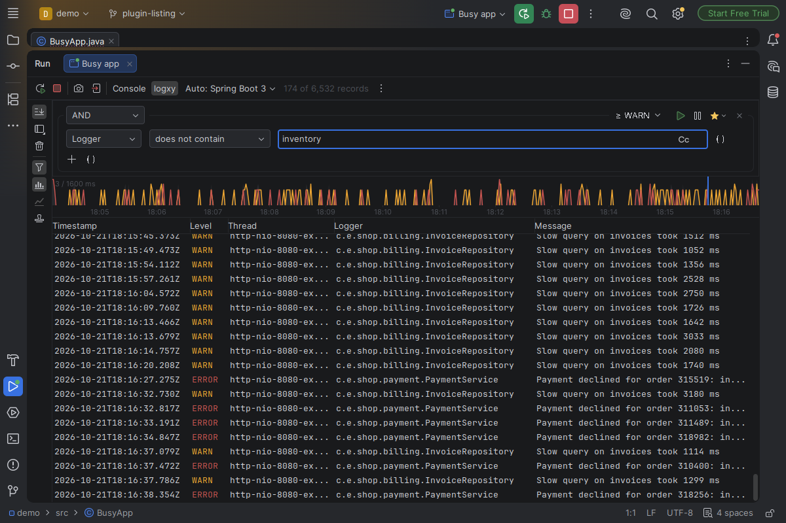

#  logxy

**A fast desktop viewer for large log files.** It opens a 10 GB log in under two seconds and filters it in under a second, and it can merge several files by time and follow them as they grow.

[](https://github.com/rastislavpapp/logxy/actions/workflows/build.yml)
[](LICENSE)
[](https://ko-fi.com/rastislavpapp)


## Features

<!-- The IntelliJ plugin's overview in logxy-intellij-plugin/src/main/resources/META-INF/plugin.xml describes the shared features too; keep the two in step. -->

- **Large files.** Multi-GB logs open in seconds and scroll smoothly.
- **Formats detected for you.** Log4j and logback patterns, Spring Boot's default log output, Python's logging, JSON lines (logstash and ECS style), logfmt, CSV files with a header row (`.csv`, comma or semicolon separated), MDC maps (one column per key) and raw text are recognised from the first lines. For a format logxy doesn't know, it infers a parser from the lines themselves. You can also define your own with a pattern, a regex or a JSON key mapping, or save a detected one and adjust it.
- **Visual filters.** Combine conditions on any column in all / any / none groups: contains, wildcards, regular expressions, case-sensitive matching, level and time ranges. Or type the filter as text, such as `level >= WARN AND thread == "main*"`. Right-click a cell to copy it or filter by its value. Save filters for later.
- **Row highlights.** Give the rows a query matches a background colour, in every log you open, to spot them without filtering the rest away.
- **Time histogram.** Record volume with warnings and errors over time, and where search matches fall. Click to jump there, drag to narrow to a time range.
- **Templates.** logxy groups lines that are the same message with different values: `Request 4711 done in 12 ms` and `Request 4712 done in 230 ms` are both `Request {1} done in {2} ms`. The Templates panel lists these message kinds with how often each occurs, so you can show or hide a whole kind at once, and chart a value, such as the duration, over time.
- **Merging.** Open several files together in one session, interleaved by timestamp, even when each needs a different parser. A Source column tells the files apart.
- **Following.** Live files are tailed as they grow, including rotation and truncation.
- **Recent sessions.** Reopen a closed session with its files, parsers, filter and position, or have the sessions open at exit reopen on start.
- **Compressed files and folders.** Open `.zip`, `.gz` and `.zst` files, or a whole folder of logs.
- **Themes.** Light and dark, with a choice of FlatLaf and IntelliJ themes.
- **IntelliJ plugin.** The same viewer in the Run and Debug tool windows of IntelliJ-based IDEs; see [below](#intellij-plugin).


## IntelliJ plugin

The plugin turns the Run and Debug consoles of IntelliJ IDEA and other IntelliJ-based IDEs into a log viewer. 
A run's output shows as parsed columns that you can filter, search and follow live, with the time histogram and templates beside them. 
The format is detected from the first lines, and the IDE's own console stays one click away: a logxy tab beside the Console tab, in Run and in Debug.



To install it, in an IDE from 2025.3 on:

1. Download `logxy-intellij-plugin-<version>.zip` from the [Releases page](https://github.com/rastislavpapp/logxy/releases).
2. In *Settings › Plugins*, click the gear icon, then *Install Plugin from Disk…*, and pick the zip.
3. Run or debug something: the tab has a logxy tab beside its Console tab.

## Download

Packages with a bundled Java runtime for Windows and Linux are on the [Releases page](https://github.com/rastislavpapp/logxy/releases): unpack and run. The release also contains a plain `logxy.jar` for any system with JDK 25 or newer.

macOS is untested and unsupported. logxy is a Java application, so it may well work there when run from the jar.

## Build and run

```sh
./gradlew :app:run
```

Needs JDK 25 with GUI support; see [CONTRIBUTING.md](CONTRIBUTING.md) for the setup, tests and benchmarks.

## Contributing

Issues and pull requests are welcome. Please read [CONTRIBUTING.md](CONTRIBUTING.md) first.

## Support

logxy is free and developed in spare time. If it saves you time, you can support its development on [Ko-fi](https://ko-fi.com/rastislavpapp) or through [GitHub Sponsors](https://github.com/sponsors/rastislavpapp). Bug reports and stars help too.

A bug report is easier to follow with logxy's log. The app writes it to `logs/logxy.log` in its settings folder (`%APPDATA%\logxy` on Windows, `~/.config/logxy` elsewhere); for more detail, such as why a file opened as Raw text, add `<Logger name="io.github.rastislavpapp.logxy" level="debug"/>` under `<Loggers>` in `log4j2.xml` there. The IntelliJ plugin logs to the IDE's `idea.log` (Help › Show Log in Explorer, Finder or Files); turn on more detail with Help › Diagnostic Tools › Debug Log Settings and the line `io.github.rastislavpapp.logxy`.

## AI disclosure

This project is developed with the help of AI coding tools, primarily [Claude Code](https://claude.com/claude-code). The files for AI agents (`AGENTS.md` and `docs/agents/`) are kept in the repository.

## License

[MIT](LICENSE) © Rastislav Papp. The libraries and fonts the app and the plugin bundle, and their licences, are listed in [THIRD-PARTY-LICENSES.md](THIRD-PARTY-LICENSES.md).
