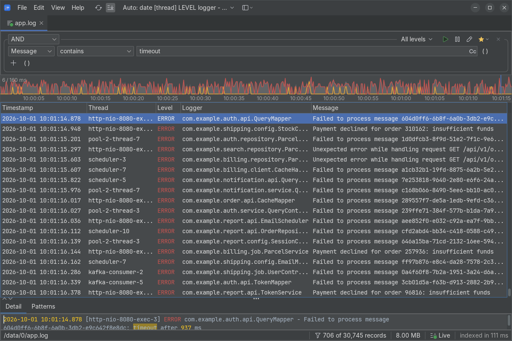
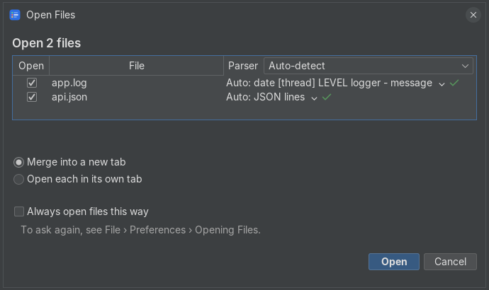

#  logxy

**A fast desktop viewer for large log files.** It opens a 10 GB log in under two seconds and filters it in under a second, and it can merge several files by time and follow them as they grow.

[](https://github.com/rastislavpapp/logxy/actions/workflows/build.yml)
[](LICENSE)
[](https://ko-fi.com/rastislavpapp)



## Features

- **Large files.** Multi-GB logs open in seconds and scroll smoothly.
- **Structured parsing.** Log4j and logback patterns, Spring Boot's default log output, JSON lines (logstash and ECS style), logfmt, CSV files with a header row (`.csv`, comma or semicolon separated), MDC maps (one column per key) and raw text. logxy picks the right parser automatically, and you can define your own with a pattern, a regex or a JSON key mapping.
- **Filtering.** Combine conditions on any column with AND, OR and NOT, either in a visual editor or as a text expression such as `level >= WARN AND thread == "main*"`. Wildcards, regular expressions, case-sensitive matching, level and time ranges are supported. Save filters for later.
- **Merging.** Open several files together in one session, interleaved by timestamp, even when each needs a different parser. A Source column tells the files apart.
- **Following.** Live files are tailed as they grow, including rotation and truncation.
- **Time histogram.** See where the errors and warnings are, and where your search matches fall, then jump there.
- **Compressed files and folders.** Open `.zip`, `.gz` and `.zst` files, or a whole folder of logs.
- **Themes.** Light and dark, with a choice of FlatLaf and IntelliJ themes.



## Download

Packages with a bundled Java runtime for Windows and Linux are on the [Releases page](https://github.com/rastislavpapp/logxy/releases): unpack and run. The release also contains a plain `logxy.jar` for any system with JDK 25 or newer.

macOS is untested and unsupported. logxy is a Java application, so it may well work there when run from the jar.

## Build and run

```sh
./gradlew :app:run
```

Needs JDK 25 with GUI support; see [CONTRIBUTING.md](CONTRIBUTING.md) for the setup, tests and benchmarks.

## Contributing

Issues and pull requests are welcome. Please read [CONTRIBUTING.md](CONTRIBUTING.md) first.

## Support

logxy is free and developed in spare time. If it saves you time, you can support its development on [Ko-fi](https://ko-fi.com/rastislavpapp) or through [GitHub Sponsors](https://github.com/sponsors/rastislavpapp). Bug reports and stars help too.

## AI disclosure

This project is developed with the help of AI coding tools, primarily [Claude Code](https://claude.com/claude-code). The files for AI agents (`AGENTS.md` and `docs/agents/`) are kept in the repository.

## License

[MIT](LICENSE) © Rastislav Papp
